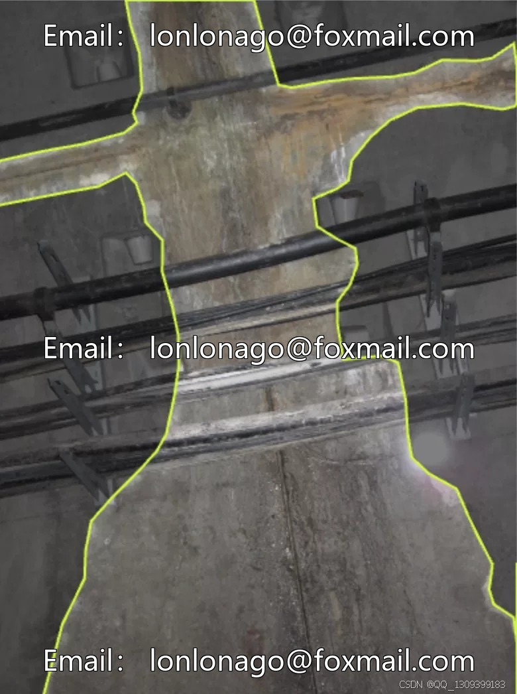
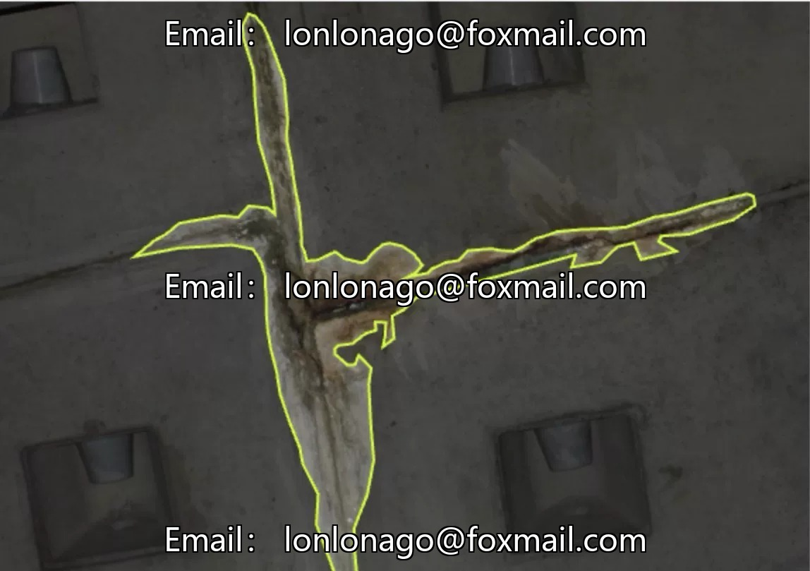
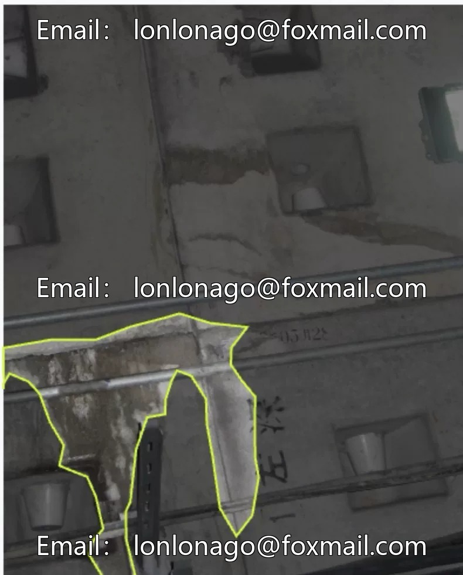
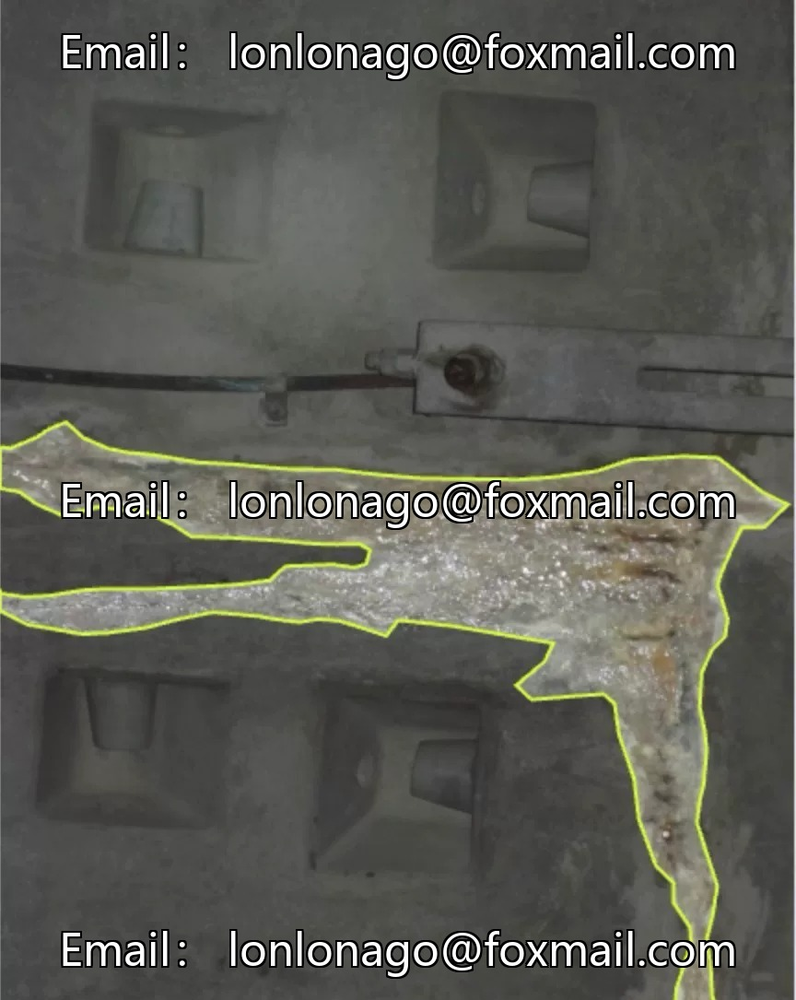
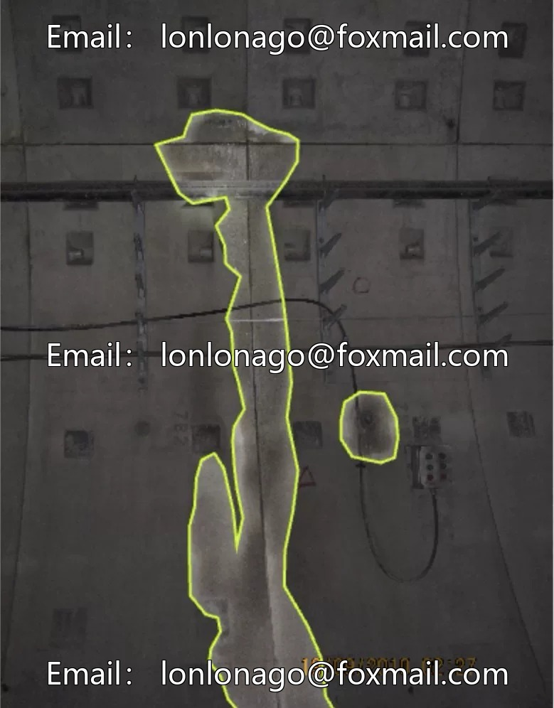

# Tunnel seepage detection dataset, subway underground tunnel leakage detection, 2758 images

## Body

Tunnel water seepage identification dataset, subway underground tunnel leak detection, 2758 images, computer vision object detection dataset, suitable for leak detection model training and optimization.

The dataset contains a large number of images related to tunnel seepage, in the format of image files + annotation files. It can be directly used for the development of target detection models, supporting algorithms such as YOLO and yolov8.

Virtual materials, once sold, are non-refundable.
Interested friends, click "I want" to proceed.

## Images

## Payment

Here is a pay link on Stripe ( https://buy.stripe.com/3cs8yP7sY87d0vu9AB ). Please contact me lonlonago@foxmail.com after funding $89, and I will send you a complete data files , thank you!

